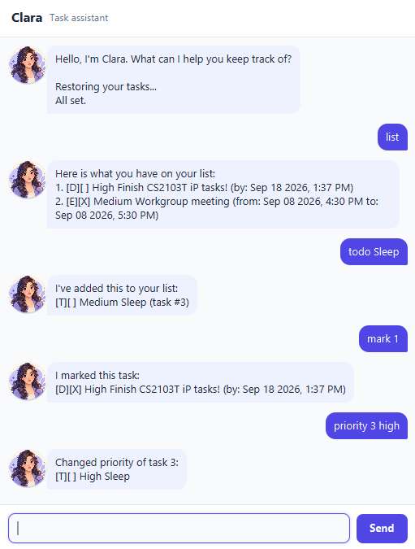

# Clara User Guide

Clara is a personal assistant that manages a list of tasks.

## Using the graphical interface



Run Clara to open its chat window. Type a command in the text field at the bottom, then press
`Enter` or select `Send`. Your messages appear on the right, while Clara's replies appear on the
left. The conversation scrolls automatically as new messages are added.

Enter `bye` to display Clara's farewell and close the application. `bye` does not accept any
additional text; for example, `bye later` is reported as an invalid command.

## TL;DR — command summary

| Command | What it does | Example |
| --- | --- | --- |
| `list` | Lists all tasks. | `list` |
| `todo <description>` | Adds a task without a date or time. | `todo buy groceries` |
| `deadline <description> /by <time>` | Adds a task due at a specified time. | `deadline submit report /by 2026-12-01 2359` |
| `event <description> /from <start-time> /to <end-time>` | Adds a task with a start and end time. | `event team meeting /from 2026-12-02 1400 /to 2026-12-02 1500` |
| `mark <task-number>` | Marks a task as done. | `mark 1` |
| `unmark <task-number>` | Marks a task as not done. | `unmark 1` |
| `priority <task-number> <priority>` | Changes a task's priority to `low`, `medium`, or `high`. | `priority 1 high` |
| `delete <task-number>` | Removes a task. | `delete 1` |
| `find <target>` | Finds tasks whose names contain the target text. | `find report` |
| `bye` | Closes Clara. | `bye` |

## Listing tasks

Enter `list` to display all added tasks in order.

## Adding tasks

Add a task using one of these commands:

- `todo <description>` - a task without a date or time.
- `deadline <description> /by <time>` - a task due by a specified time.
- `event <description> /from <start-time> /to <end-time>` - a task with start and end times.

Times must be of the format `yyyy-MM-dd HHmm`. Internally they are also stored that way.

The character `|` is reserved for Clara's save format and cannot be used in task details.

## Example outputs

The following examples show the text Clara displays in the GUI after common commands.

```text
You: todo buy groceries

Clara:
I've added this to your list:
[T][ ] Medium buy groceries (task #1)
```

```text
You: deadline submit report /by 2026-12-01 2359

Clara:
I've added this to your list:
[D][ ] Medium submit report (by: Dec 01 2026, 11:59 PM) (task #2)
```

```text
You: priority 1 high

Clara:
Changed priority of task 1:
[T][ ] High buy groceries
```

```text
You: list

Clara:
Here is what you have on your list:
1. [T][ ] High buy groceries
2. [D][ ] Medium submit report (by: Dec 01 2026, 11:59 PM)
```

## Marking tasks as done

Enter `mark <task-number>` to mark a task as done, or `unmark <task-number>` to mark a task as not done.
The task number is the number shown in the output of doing `list`.

## Setting task priority

Enter `priority <task-number> <low|medium|high>` to set a task's priority. New tasks have
`Medium` priority by default. Task listings show the priority after the completion status; for
example, `[X] High submit report`.

## Deleting tasks

Enter `delete <task-number>` to remove a task from the list.
The task number is the number shown in the output of doing `list`.

## Saving tasks

Clara automatically saves the task list after you add, mark, unmark, delete, or change a task's
priority. When Clara starts, it restores the previously saved task list.

## Finding tasks

Enter `find <target>` to find tasks with names containing the search target.

## Handling invalid commands

Clara explains invalid commands and inputs, then lets you try again. For example, `delete` without a valid task number displays the required command format.

```text
You: delete tomorrow

Clara:
I couldn't make sense of that:
Use: delete <task number>.
Please try again.
```

If the task number is valid in format but does not exist, Clara identifies the missing task.

```text
You: mark 99

Clara:
I couldn't make sense of that:
There is no task 99.
Please try again.
```

## Exiting the app

Enter `bye` to exit the app.

*Co-maintained by Codex.*
